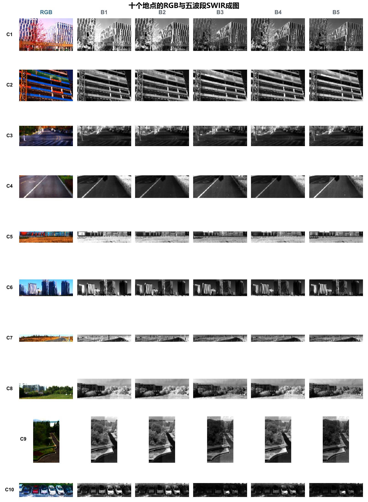

# M-SWIR-RGB：RGB 与五波段短波红外配对数据集

**论文：面向跨光谱图像生成的场景级 RGB 与五波段短波红外配对数据集**

[阅读最新版中文论文](output/pdf/main_zh_latest.pdf) · [论文源稿](main_zh.tex) · [实验结果与证据](figures/source_data/results_20261109/) · [编译与使用指南](docs/usage.md)

M-SWIR-RGB 面向短波红外（SWIR）到 RGB 的跨光谱图像生成研究，包含十个物理地点的 RGB 与五个 SWIR 子波段配对观测。论文关注三个问题：多波段信息能否改善生成结果，空间划分如何影响评价，以及少量目标地点配对样本能带来怎样的改善。

本工作的贡献是**可追溯的配对数据、地点隔离的评价协议和明确的使用边界**。DRUNet、pix2pix 与 TFD-GAN 用于验证数据集的用途，本文不提出新的生成模型。

## 数据集概览

| 项目 | 当前数据规模与定义 |
|---|---|
| 采集地点 | 10 个不同物理地点，编号 C1–C10 |
| 重叠采集视野 | 140 个 |
| 模态 | RGB + B1–B5，共 6 种模态 |
| 采集档案 | 1,281 幅图像，包含 RGB 连拍候选 |
| 实际参与成图的源帧 | 840 幅：140 幅 RGB + 700 幅 SWIR |
| 场景级成图 | 60 幅：每地点 1 幅 RGB 和 5 幅 SWIR |
| 六模态共同有效支持 | 88,861,466 个像素 |
| 候选窗口 | 5,893 个，窗口 256 × 256、步长 128 |

候选窗口按当前几何、隐私及共同动态范围规则筛选，具有空间重叠；其数量不代表独立场景或已完成人工验收的样本数。RGB 与 SWIR 通过共孔径二向色分光平台采集，五个 SWIR 通道分时曝光。源帧身份、几何变换、裁切、强度处理及评价支持共同构成数据的追溯记录。

| SWIR 通道 | 名义中心波长 / nm | 名义通带 / nm | 带宽 / nm |
|---|---:|---|---:|
| B1 | 1025 | 1000–1050 | 50 |
| B2 | 1075 | 1050–1100 | 50 |
| B3 | 1250 | 1225–1275 | 50 |
| B4 | 1550 | 1525–1575 | 50 |
| B5 | 1650 | 1625–1675 | 50 |

波段由滤光片名义规格定义，系统光谱响应尚未实测。成图保存为未辐射定标的八位数字量（DN），不能直接解释为地表反射率。

查看十个地点的 RGB 与五波段 SWIR 成图总览

每行对应一个地点，每列依次为 RGB、B1、B2、B3、B4 和 B5。该图为论文中的成图预览。

## 实验设计

主基准采用**地点隔离的五折划分**：每折 6 个训练地点、2 个验证地点、2 个测试地点，十个地点各作为测试地点一次。

- **波段配置：**3 类模型 × 15 种输入 × 5 折，共 225 次训练。15 种输入包含 5 种单波段复制和 10 种三波段组合，网络均接收三通道输入。检查点和输入配置均由验证集选择，测试地点不参与选择。
- **划分敏感性：**另以 pix2pix 完成 15 种输入 × 3 个随机窗口划分，共 45 次训练；在与地点隔离协议的共同测试区域上比较分数。
- **目标地点监督：**用每地点 10 个 SWIR–RGB 配对图块拟合颜色映射，在保留区域评价，并通过半区对照检查其空间适用范围。

主结果先在各地点内计算指标，再对十个地点等权平均。神经网络训练使用单一种子，结果用于描述当前数据和实验条件下的表现。

## 主要发现

### 多波段收益依赖模型与地点

下表为验证集选择后的地点等权 PSNR，单位为 dB。

| 模型 | 单波段输入 | 三波段输入 | 三波段 − 单波段 |
|---|---:|---:|---:|
| DRUNet | 13.619 | 13.820 | +0.202 |
| pix2pix | 12.876 | 12.856 | −0.020 |
| TFD-GAN | 12.040 | 12.839 | +0.800 |

差值由未舍入数值计算。三类模型的平均色差和 LPIPS 均降低，但 PSNR、SSIM 的变化并不一致，各地点的收益也有差异。因此，当前实验不支持“更多波段必然改善所有指标”或存在通用最优波段组合的结论。

### 随机窗口划分可能给出偏乐观的分数

随机窗口对照在共同测试区域上的 PSNR 平均高出 **4.435 dB**，但约 **96.26%** 的测试像素也被训练窗口覆盖。这类成绩不能直接代表未见地点的生成能力；两种协议同时改变训练地点覆盖和样本组成，该差值也不能全部归因于像素重叠。

### 少量配对样本能改善目标地点的颜色映射

保持仿射映射形式不变，使用每地点 10 个配对图块后，保留区域 PSNR 从 **14.113 dB** 升至 **16.502 dB**。半区对照显示，同半区校准与跨半区应用的表现存在差异，校准关系具有空间适用边界。这项结果依赖目标地点的 RGB 监督，应与未见地点测试分别报告。

完整指标、逐地点结果及选择规则见[中文论文](output/pdf/main_zh_latest.pdf)、[结果汇总](figures/source_data/results_20261109/summary.json)和[实验整合说明](docs/revision_20261109.md)。

## 当前版本与数据可用性

当前中文稿已整合上述 270 次训练记录及配对校准实验，最新版 PDF 为 19 页；英文稿尚未同步这次结果更新。当前证据核验基于保存的配置、验证轨迹和结果表，不包含重新训练或从完整预测重算全部指标。

**本仓库公开的是论文材料，原始数据集尚未正式发布。** 仓库提供源稿、必要图表、数值证据和结果汇总脚本；原始数据、完整预测、模型权重及大型交付包不随仓库分发。

数据规模限于十个地点；分时曝光、未定标 DN 和单训练种子也限制了结果的外推。独立人工几何验证、全量质量与隐私验收、外部复现，以及最终数据许可、归档地址和持久标识仍待完成。

## 仓库内容

| 入口 | 内容 |
|---|---|
| [main_zh.tex](main_zh.tex) / [最新版 PDF](output/pdf/main_zh_latest.pdf) | 当前中文论文源稿与阅读版 |
| [refs.bib](refs.bib) | 参考文献 |
| [figures/zh/](figures/zh/) | 中文论文图表 |
| [generated/](generated/) | 论文使用的表格和数值宏 |
| [results_20261109/](figures/source_data/results_20261109/) | 当前实验的最小数值证据、协议和来源记录 |
| [结果汇总脚本](scripts/build_results_20261109.py) | 根据保存记录复算汇总并重建结果图表 |
| [检查记录](docs/verification_20261109.json) | 本地编译、引用、版面和数值核验记录 |

结果证据中的 `evidence_code/` 为来源代码快照，当前仓库不提供完整训练工程。仅阅读或编译论文不需要下载原始数据、模型权重或配置 GPU。

## 编译与维护

安装环境、克隆项目、编译中文论文、重建图表和同步修改的步骤集中在[项目使用与维护指南](docs/usage.md)。日常流程为：**本地编译并检查 → 最新 PDF 与源码一起提交 → 推送到 GitHub**，具体约定见 [AGENTS.md](AGENTS.md)。

GitHub Actions 保留为云端后台复核，并提供临时 PDF 产物；论文阅读入口始终是上方的最新版 PDF。历史说明和里程碑版本见[原项目记录](docs/project_history_before_github_20261109.md)及[2026-11-09 归档 PDF](output/pdf/多波段SWIR_RGB数据集_中文稿_实验整合_20261109.pdf)。
